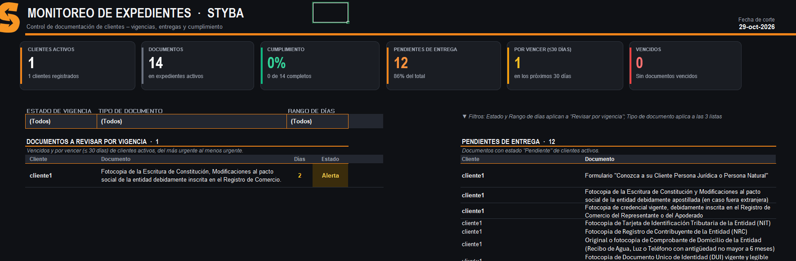
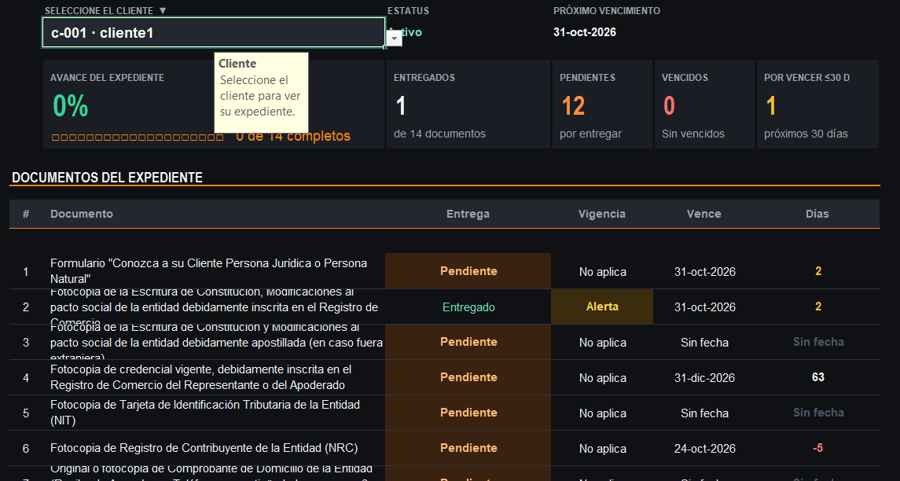
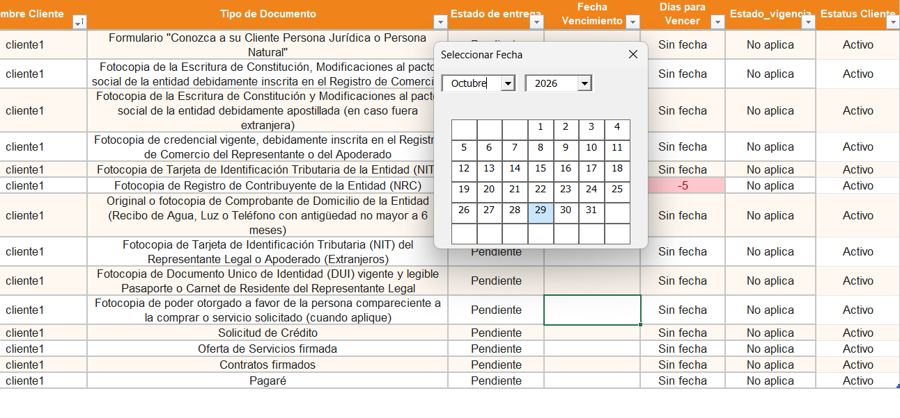

# 📂 Sistema Híbrido de Control de Expedientes (STYBA)

## 📌 Descripción del Proyecto
Desarrollo e implementación de un sistema automatizado para la gestión, seguimiento y trazabilidad de expedientes documentales. El proyecto optimiza el control documental, reduciendo la dependencia de registros manuales y mejorando la precisión operativa.

---

## 🎯 Objetivo y Problemática
* **Problemática:** Ineficiencia y falta de trazabilidad centralizada en la localización, registro y actualización del estado de los expedientes.
* **Objetivo:** Diseñar una herramienta en Excel potenciada con VBA para automatizar el ciclo de vida del expediente (ingreso, consulta y generación de reportes).

---

## 🛠️ Tecnologías y Herramientas
* **Microsoft Excel:** Base de datos estructurada e interfaz gráfica.
* **VBA (Visual Basic for Applications):** Lógica de programación, manipulación de datos y automatización.

---

## 💡 Funcionalidades Clave
* 📝 **Formulario de Registro:** Captura estandarizada con validaciones de campos obligatorios para evitar incoherencias.
* 🔍 **Búsqueda y Filtrado Dinámico:** Consulta rápida de expedientes por código, fecha o estado sin modificar la hoja base.
* 🛡️ **Trazabilidad y Control:** Actualización de estados en tiempo real con control de duplicados.
* 📊 **Generación de Reportes:** Extracción automatizada de información para auditoría documental.

---

## 📂 Contenido del Repositorio
* `modDocumentos.bas`, `Hoja1.cls`, `Hoja3.cls`, `Hoja4.cls`, `Hoja6.cls`: Módulos y código de clase exportados desde el editor de Visual Basic para revisión directa.
* `Control_Expedientes_STYBA.xlsm`: Archivo Excel habilitado para macros con el sistema funcional.
* Archivos `.png`: Capturas de pantalla de la interfaz y módulos del sistema.

---

## 📸 Evidencia Visual

*Figura 1: Tablero general de control y resumen de expedientes pendientes y vencidos.*

*Figura 2: Ficha individualizada por cliente para consulta rápida de estado documental.*

*Figura 3: Selección e ingreso de fechas mediante calendario interactivo en VBA.*

---

## 📈 Resultados e Impacto
* ⏱️ **Optimización del tiempo de gestión:** Reducción drástica en el tiempo necesario para ubicar y actualizar un expediente.
* 🎯 **Estandarización:** Eliminación de inconsistencias en el formato de captura de datos.
* 🔒 **Calidad de datos:** Reducción de errores humanos mediante validaciones automáticas de sintaxis e integridad.

---

## 🔄 Flujo de Trabajo (Workflow del Usuario)

1. 👤 **Registro del Cliente:** El usuario registra un nuevo cliente y el sistema añade automáticamente a la hoja `Data` las filas correspondientes a sus documentos requeridos (por ejemplo, si le aplican 14 documentos, se generan automáticamente sus 14 registros).
2. 📝 **Control de Entregas y Vencimientos:** El operador únicamente indica si el documento ya está entregado por parte del cliente o no, especificando la fecha de vencimiento en caso de que aplique.
3. 📊 **Consolidación de Reportes:** El sistema genera automáticamente un reporte general con las alertas de expedientes pendientes a entregar o completos (entregados y vigentes), además de un reporte individual en la hoja *"Ficha Cliente"*. De esta forma, el usuario solo debe consultar el resumen de lo pendiente o vencido para tomar acción.
