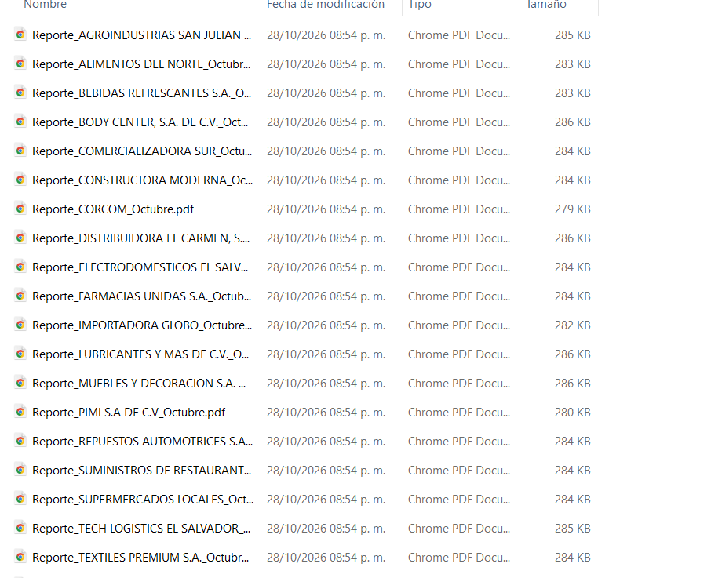

# 🏭 Fábrica de Reportes Logísticos WMS 3PL y Dashboard Automatizado

## 📌 Descripción del Proyecto
Desarrollo de un sistema en Excel/VBA para la extracción, consolidación y generación masiva de reportes de gestión logística a partir de la base de datos central de un WMS (3PL). La herramienta automatiza el filtrado individualizado por cliente y mes, exportando y organizando automáticamente los reportes consolidados en carpetas locales destinadas a distribución.

---

## 🎯 Problemática y Objetivo
* **Problemática:** La consolidación manual de KPIs y la generación individual de reportes mensuales para cada cliente desde la base del WMS requería un alto consumo de horas-hombre y presentaba riesgo de inconsistencias en la segmentación de datos.
* **Objetivo:** Diseñar un dashboard interactivo conectado a la base WMS 3PL con un motor en VBA que genere y clasifique los reportes individuales por cliente en carpetas automáticas con un solo clic.

---

## 🛠️ Tecnologías y Herramientas
* **Microsoft Excel & VBA:** Motor de procesamiento, lógica de iteración masiva y renderizado de tablas dinámicas/KPIs.
* **WMS 3PL Data Architecture:** Estructuración y modelado de datos de almacenamiento, rotación y despachos.

---

## 📊 KPIs y Métricas Monitoreadas en el Dashboard
El panel consolida los indicadores clave del servicio logístico 3PL:

* 🚚 **Nivel de Servicio y Operaciones:**
  * **Volumen Recibido:** Total de unidades ingresadas al mes.
  * **% Cumplimiento de Despacho:** Efectividad sobre pedidos procesados.
  * **Dock to Stock:** Horas promedio de recepción e ingreso a inventario.
  * **Pedido Perfecto:** Porcentaje de entregas a tiempo y sin errores.

* 📦 **Salud y Antigüedad del Inventario:**
  * **Unidades en Inventario:** Cobertura y días de rotación mensual.
  * **Unidades sin Movimiento (Aging):** Clasificación por rangos de días (`30-60`, `61-90`, `91-120` y `+120 días`).

* 🏭 **Ocupación Física del Almacén:**
  * Posiciones en Rack, Ocupación Total y Pallets en piso.

---

## 📂 Contenido del Repositorio
* `Fabrica_Reportes -V5.xlsm`: Archivo principal con el dashboard interactivo y la lógica VBA de exportación.
* `Módulo1.bas`: Código fuente en VBA exportado para auditoría directa del motor de automatización.
* `carpeta_de_reportes_creada_por_la_macro.png`: Evidencia de la estructura de carpetas generada automáticamente por la macro.

---

## 📸 Evidencia Visual

*Figura 1: Tablero de control interactivo con filtros dinámicos por cliente/mes y botón de ejecución masiva.*

---

## 🔄 Flujo de Trabajo (Workflow del Usuario)

1. 📥 **Carga de Datos:** Actualización de la tabla base extraída del sistema WMS 3PL.
2. 🎛️ **Selección de Parámetros:** El usuario puede seleccionar un cliente y mes específico para consulta puntual en pantalla, o iniciar la generación global.
3. ⚡ **Ejecución Automática:** Al presionar el botón **`GENERAR REPORTES`**, el script en VBA:
   * Recorre la lista maastra de clientes.
   * Filtra los datos correspondientes en el modelo.
   * Crea la estructura de carpetas de destino si no existe.
   * Exporta cada reporte en el formato definido (PDF/Excel) de forma individualizada.