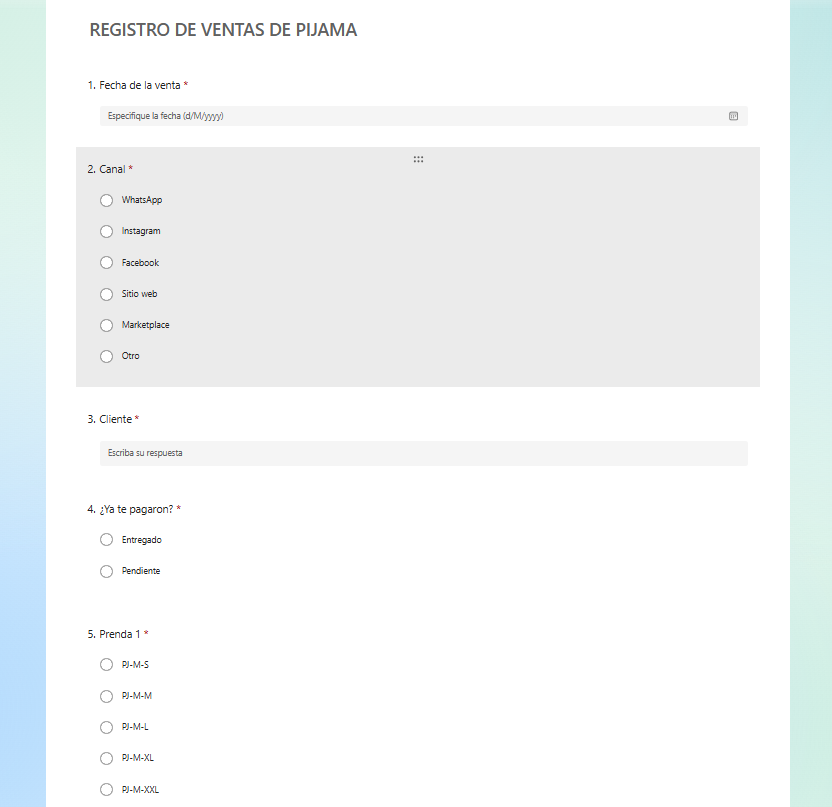
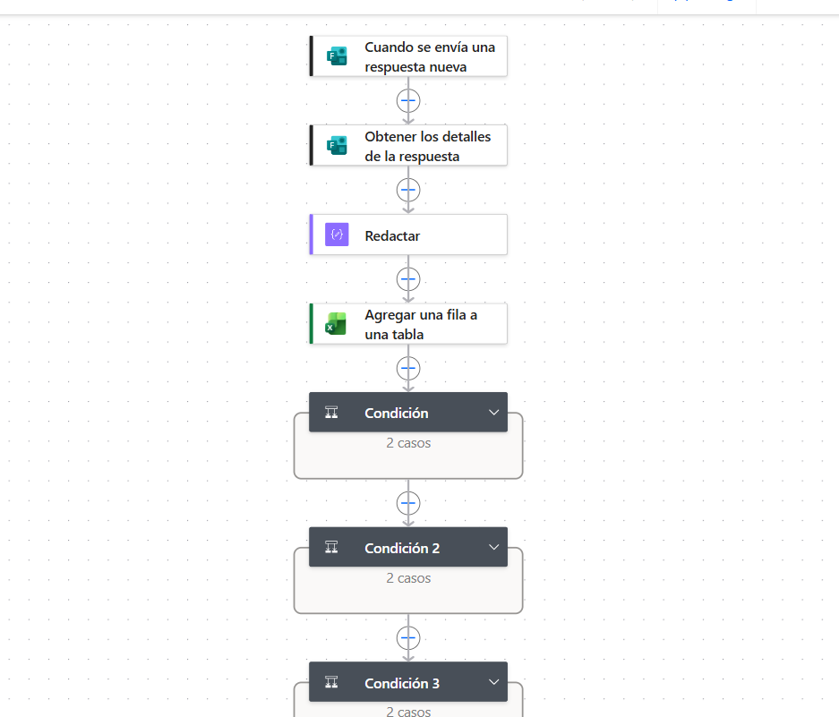
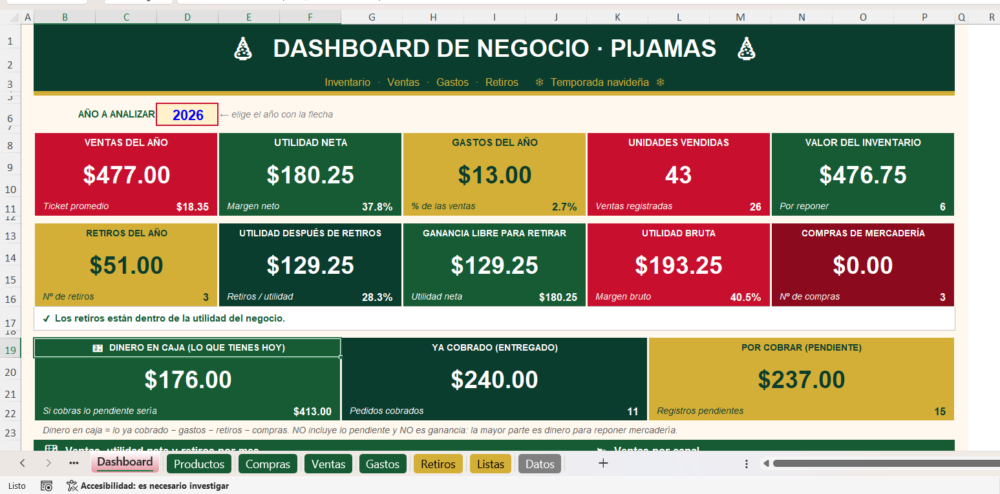

# 🎄 Sistema de Automatización de Ventas y Estado de Resultados (Retail Estacional)

## 📌 Descripción del Proyecto
Diseño e implementación de un flujo de captura de datos y consolidación financiera para un emprendimiento de retail estacional (venta de pijamas navideñas). El sistema utiliza un formulario digital móvil integrado con **Power Automate** para procesar y registrar automáticamente cada venta en una base de datos centralizada en **Excel**, generando un **Estado de Resultados** en tiempo real y segregando de forma independiente los retiros de capital para proteger la precisión de la utilidad operativa.

---

## 🎯 Problemática y Objetivo
* **Problemática:** La captura manual de ventas en entornos de comercio directo suele generar omisiones de datos, lentitud en el registro y confusión entre los ingresos netos del negocio y los retiros personales del propietario, distorsionando la rentabilidad real.
* **Objetivo:** Automatizar la entrada de datos desde dispositivos móviles para eliminar la carga operativa de digitación, centralizar la información en Excel y estructurar un Estado de Resultados técnicamente correcto que aísle los retiros personales de los costos y gastos del proyecto.

---

## 🛠️ Tecnologías y Arquitectura
* **Microsoft Forms:** Interfaz simplificada para la captura de ventas en punto de venta / movilidad.
* **Power Automate:** Flujo automatizado en la nube para la extracción, transformación ligera e inserción de datos en tiempo real.
* **Microsoft Excel:** Base de datos relacional simple, lógica de fórmulas financieras y Estado de Resultados.
* **Prompt Engineering (Claude):** Apoyo en la estructuración de la sintaxis y modelado de las plantillas financieras iniciales.

---

## 📊 Arquitectura Financiera y Control de Retiros
El modelo contable del proyecto se enfoca en la evaluación estricta del margen operativo:

* 📈 **Estado de Resultados:**
  * **Ingresos Brutos:** Ventas totales registradas por formulario.
  * **Costo de Ventas (COGS):** Costo directo de adquisición de la mercadería.
  * **Margen Bruto:** Rentabilidad directa sobre el producto.
  * **Gastos Operativos:** Costos logísticos, empaque y comercialización.
  * **Utilidad Neta del Periodo:** Resultado operativo real del ejercicio estacional.

* 🛡️ **Módulo de Segregación de Retiros:**
  * Se implementó un registro separado para los retiros personales/capital del propietario. Al no ser clasificados como gastos operativos ni costos directos, el Estado de Resultados refleja la verdadera rentabilidad técnica del negocio sin sesgos de flujo de caja personal.

---

## 📂 Contenido del Repositorio
* `pijamas_navidad_conciliado (2).xlsx`: Modelo financiero central con tablas estructuradas y Estado de Resultados.
* `formulario.png`: Captura de pantalla de la interfaz de registro de ventas.
* `flujo_powerAutomate.png`: Diagrama del flujo automatizado en Power Automate.
* `dashboard.png`: Dashboard analítico del rendimiento comercial y financiero.

---

## 📸 Evidencia Visual

*Figura 1: Interfaz ágil del formulario para el registro inmediato de ventas.*

*Figura 2: Flujo en la nube para la conexión automática entre el formulario y la hoja de cálculo.*

*Figura 3: Panel de control con el Estado de Resultados y métricas clave de venta.*

---

## 🔄 Flujo de Trabajo (Workflow)

1. 📱 **Ingreso de la Venta:** El operador/vendedor registra los datos de la transacción (cantidad, producto, monto) desde su teléfono móvil a través del formulario.
2. ⚡ **Procesamiento en la Nube:** Power Automate detecta la nueva respuesta, valida la estructura de los datos y añade la fila correspondiente en la tabla de Excel de forma instantánea.
3. 📊 **Actualización Contable:** La hoja de Excel actualiza de manera automática el Estado de Resultados y recalcula los márgenes de ganancia.
4. 💸 **Control de Retiros:** Los movimientos de dinero retirados por el propietario se asientan en un módulo independiente, manteniendo intacta la contabilidad operativa del proyecto.