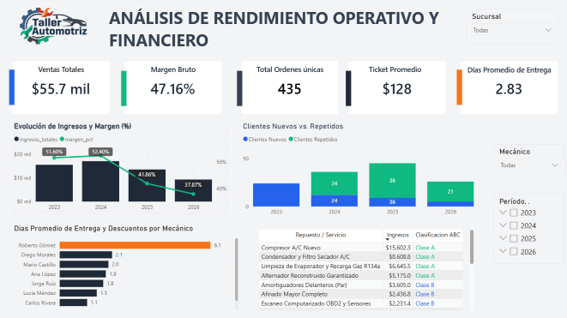

# 🔧 Optimización Operativa y Financiera — Taller Automotriz (Power BI)

## 📌 Resumen del Proyecto
Solución integral de **Business Intelligence** desarrollada en **Power BI Desktop** (Power Query, Power Pivot, Modelado Dimensional en Esquema Estrella y DAX) para auditar la operación financiera y técnica de un taller automotriz con sedes en **San Salvador** y **Santa Tecla** (periodo **2023 – septiembre 2026**, 435 órdenes únicas / 697 registros).

👉 **[Haz clic aquí para explorar el Dashboard Interactivo en vivo](https://app.powerbi.com/view?r=eyJrIjoiNzcyNjk3ZDQtNjk3NC00ZThiLWIyZjktYTAyZDk3MzBhODIwIiwidCI6ImY5YWZlMDIwLTE0ZTgtNDU1NS1iNjM4LWI5OGY4OTZhYTk0YiIsImMiOjR9)** *(no requiere iniciar sesión).*

---

## 📂 Estructura del Repositorio

| Archivo | Descripción |
| :--- | :--- |
| **`proyecto_tallerAutomotriz.pbix`** | Archivo fuente de Power BI Desktop con el modelo Estrella, medidas DAX y visualizaciones. |
| **`Caso de Estudio BI - Optimizacion Operativa y Financiera.pdf`** | Informe ejecutivo completo: problemática, pipeline ETL, fórmulas DAX, hallazgos y recomendaciones. |
| **`Datos.xlsx`** | Libro maestro procesado mediante **Power Query** (tablas limpias, normalizadas y listas para el modelo). |
| **`Datos_taller_sucios.xlsx`** | Dataset crudo original (con celdas combinadas, duplicados, nulos y sufijos de texto `"USD"` en precios). |
| **`Dim_Mecanicos.csv`** | Archivo fuente adicional del catálogo de personal técnico. |

---

## ⚙️ Proceso ETL y Limpieza de Datos (`Datos.xlsx`)
En el archivo `Datos.xlsx` se documenta y ejecuta la transformación completa desde los datos crudos (`Datos_taller_sucios.xlsx`) utilizando **Power Query**:
* **Normalización estructural:** Uso de *Rellenar hacia abajo (Fill Down)* en categorías de repuestos y tipo de combustible para corregir celdas combinadas de Excel.
* **Limpieza monetaria:** Eliminación de sufijos de texto (`"USD"`) y espacios en `PrecioNeto` antes de convertir a tipo Moneda Decimal.
* **Integridad de dimensiones:** Consolidación (*Append*) de tablas de clientes, imputación de nulos (`"Desconocido"`), limpieza con *Trim / ProperCase*, separación de Nombre/Apellido y eliminación de duplicados sobre llaves primarias y compuestas (`OrdenKey + Linea`).

---

## 🔍 Principales Hallazgos de Negocio
1. **Colapso de margen estacional:** El margen bruto global cayó de `52.40%` (2024) a `37.87%` (2026), impulsado por promociones mal costeadas en **Aire Acondicionado** durante marzo–abril (`4.76%` de margen).
2. **Ilusión de productividad técnica:** Roberto Gómez lideró el volumen de líneas (`180`), pero generó apenas `$27.67` promedio por registro, acumuló `$1,404.70` en descuentos no autorizados y promedió `6.11 días` de entrega (más del doble del promedio del taller de `2.83 días`).
3. **Fuga de clientes en Santa Tecla:** Caída de clientes recurrentes tras la salida del especialista en Frenos y Suspensión (`Lucía Méndez`), mientras San Salvador sostuvo su facturación mediante Flotas Comerciales.
4. **Pareto ABC de Inventario:** 4 ítems Clase A (*Compresor A/C*, *Condensador*, *Limpieza Evaporador* y *Alternador*) generan el **70% de los ingresos**, mientras repuestos costosos Clase C (*Sensor MAF*, *Módulo BCM*) inmovilizan capital.

---
**Autor:** Elías Yoel Romero Sánchez — *Data & Business Intelligence Analyst*